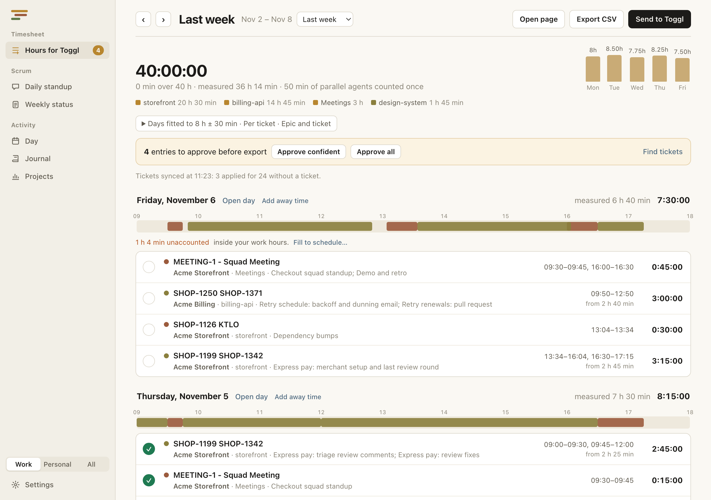
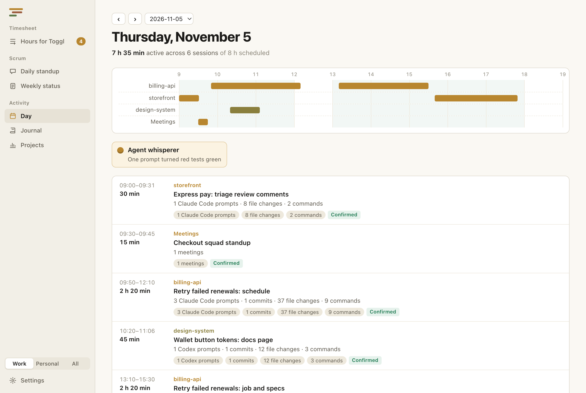
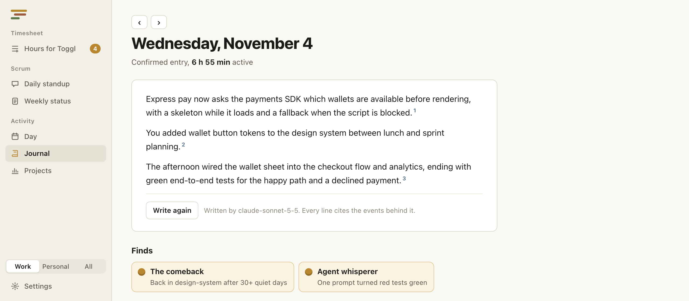
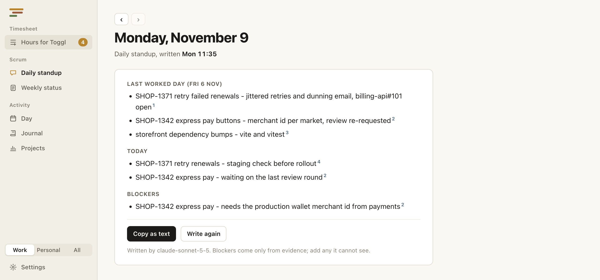
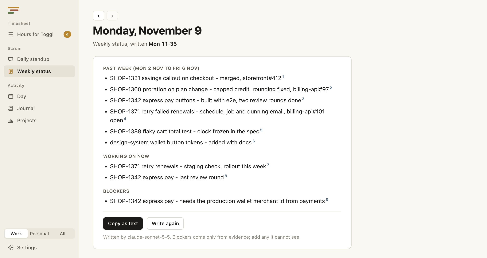
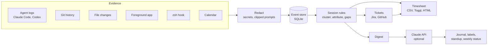

# Dev Archaeologist

[](https://github.com/higorhlg/dev-archaeologist/actions/workflows/ci.yml)
[](LICENSE)

A local-first macOS app that rebuilds what you worked on from evidence your tools already keep,
and turns it into a timesheet, a journal and standup notes you can trust.

<picture>
  <source media="(prefers-color-scheme: dark)" srcset="docs/screenshots/timesheet-dark.png">
  
</picture>

It reads Claude Code and Codex session logs, Git history, file changes, the foreground app, your
calendar and a small zsh hook. Fixed rules group that evidence into work sessions; nothing is
guessed by a model. The Claude API is optional and only writes prose (journal entries, session
labels, status updates) from a short redacted digest, and every line it writes cites the events
behind it.

## Why

Working across several repos with coding agents running in parallel, the honest answer to "what
did I do on Tuesday, and for how long?" is spread over a dozen logs. Dev Archaeologist digs it
back out, so a week of time entries takes a couple of minutes instead of an hour of guessing,
and each entry can show why it says what it says.

## What it does

- **Timesheet.** Sessions become time entries with a project, a ticket and a description in
  your own format, such as `EPIC TICKET`. Days can be fitted to a target (say 8 hours, drifting
  in quarter hours toward how long you were really there) while meetings stay at their calendar
  time and time away stays empty. Export a Toggl CSV, send entries to Toggl, or open a readable
  HTML page.
- **Tickets from evidence.** A session takes its Jira ticket or GitHub pull request from branch
  names, commit scopes, `gh pr` commands an agent ran and tickets an agent touched. "Find
  tickets" asks Jira and GitHub for the rest: an exact match applies on its own, a close call
  waits for you.
- **A reviewable day.** A timeline of sessions you can relabel, exclude or approve, with gaps
  inside your work hours surfaced for a decision instead of silently filled.
- **Journal.** A short daily entry with cited lines, plus "finds" such as a prompt that
  turned red tests green.
- **Scrum.** A daily standup and a weekly status (done, now, blockers) written from work
  sessions only, ready to copy into chat. They write themselves each work day and on your weekly
  meeting day.
- **Weekly report.** A Markdown file per ISO week: time per project and ticket, each day against
  your work hours, the journal, and what still needs attention.
- **Work and personal.** Projects are sorted into two sides, and the timesheet only ever sees
  the work side.
- **Headless.** `dev-arch` runs the same core from the terminal, and a LaunchAgent can keep it
  syncing while the app is closed.

## A look around

The screenshots show a made-up week, generated from synthetic evidence.

**A day.** Sessions per project on a timeline, each with the evidence behind it. Agents working in
parallel on two projects overlap, and their shared minutes count once.

<picture>
  <source media="(prefers-color-scheme: dark)" srcset="docs/screenshots/day-dark.png">
  
</picture>

**The journal.** A few cited lines about the day, and its finds.

<picture>
  <source media="(prefers-color-scheme: dark)" srcset="docs/screenshots/journal-dark.png">
  
</picture>

**Scrum.** The daily standup and the weekly status, ready to copy into chat.

<picture>
  <source media="(prefers-color-scheme: dark)" srcset="docs/screenshots/standup-dark.png">
  
</picture>

<picture>
  <source media="(prefers-color-scheme: dark)" srcset="docs/screenshots/weekly-dark.png">
  
</picture>

## How it works



1. **Collect.** Adapters read past logs (a 90-day backfill on first run) and live collectors
   watch files, the foreground app and the shell. Every source can be switched off.
2. **Redact.** Events are scrubbed on the way in: secrets are removed and prompts are clipped to
   200 characters.
3. **Cluster.** Deterministic rules group events into sessions per project, measure active time,
   and mark gaps against your work hours. A session moves through `observed → inferred → edited →
   confirmed`, or `excluded`.
4. **Attribute.** Tickets are detected from the evidence, then confirmed against Jira and GitHub.
5. **Write.** Reports are computed locally. Prose comes from the Claude API when a key is set,
   and a line is kept only when everything it cites exists in the digest that was sent.

## Privacy

- Everything lives in one SQLite file: `~/Library/Application Support/dev-archaeologist/devarch.db`.
  Override it with `DEV_ARCH_DB`.
- Agent logs: prompts are clipped to 200 characters and scrubbed; tool output is read only to
  count test runs.
- Terminal: the hook sends the command name only, never its arguments.
- The Claude API receives one short digest per call. Projects listed under "never leave this
  Mac" are left out of it.
- Secrets (Claude, Jira and Toggl tokens) stay in the macOS Keychain, or come from
  `ANTHROPIC_API_KEY`.
- Weekly reports are written to `reports/` next to the database.

## Getting started

Requirements: macOS, [Rust](https://rustup.rs) (stable), Node 22 or newer and
[pnpm](https://pnpm.io).

```sh
pnpm install
pnpm tauri dev                # the app, with hot reload
pnpm tauri build --debug      # .app bundle in src-tauri/target/debug/bundle/macos
```

The first launch shows what a scan would read, imports it, then asks for your work hours. An API key, Jira, GitHub
(through the `gh` CLI), Toggl and Calendar access are all optional and live in Settings.

## The `dev-arch` CLI

```sh
cd src-tauri && cargo build --bin dev-arch
./target/debug/dev-arch discover 90             # what a first scan would read
./target/debug/dev-arch backfill 90             # read past logs into the local store
./target/debug/dev-arch day 2026-10-06          # a day's sessions and finds
./target/debug/dev-arch journal 2026-10-06      # write the day's journal
./target/debug/dev-arch standup 2026-11-02      # standup for a meeting that day
./target/debug/dev-arch week-status 2026-11-02  # weekly status for a meeting that day
./target/debug/dev-arch report 2026-10-26 2026-10-30 --tickets epic_ticket --fit 8 --drift 30 --csv --html
./target/debug/dev-arch sync                    # catch up, sync tickets, run the daily journal, status updates and weekly report
./target/debug/dev-arch sync-agent install 30   # run `sync` every 30 min while the app is closed
./target/debug/dev-arch weekly 2026-10-19       # write that week's report to reports/2026-W43.md
./target/debug/dev-arch hook                    # install the zsh hook file
```

`dev-arch` with no arguments prints the name of every command. The sync agent reads the same Keychain items as
the app; macOS asks once per new `dev-arch` binary, and "Always Allow" keeps unattended runs from
waiting on the prompt.

## Project layout

```
src-tauri/            Rust core, shared by the app and the CLI
  src/adapters/       readers for past evidence: agent logs, git, calendar, shell refs
  src/collectors/     live watchers: files, foreground app, shell socket
  src/sessions/       clustering, attribution and gap rules
  src/trackers/       Jira and GitHub lookups and the ticket matcher
  src/infer/          Claude API client, digest, journal and status updates
  src/reports.rs      timesheet entries, fitting and descriptions
  src/store.rs        SQLite store (schema in migrations/)
  src/bin/dev-arch.rs the CLI
ui/                   React and TypeScript front end
shell/                the zsh hook
docs/plans/           design plans written before building
```

## Development

```sh
cd src-tauri && cargo test --lib   # core rules, parsers and report maths
pnpm build                         # type-check and build the front end
```

Built with Tauri 2, Rust, SQLite, React 19, TypeScript and Vite. Changes are recorded in
[CHANGELOG.md](CHANGELOG.md), and the product and design principles in [PRODUCT.md](PRODUCT.md).

## Status

A personal tool in daily use by its author. It targets macOS only (Keychain, Calendar,
LaunchAgents and the foreground-app collector are macOS APIs), and the timesheet export speaks
Toggl.

## License

[MIT](LICENSE)
